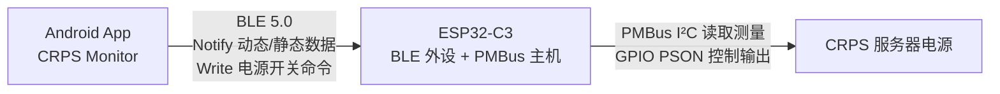

# CRPS Monitor (Compose)

CRPS 服务器电源实时监控 Android 应用，基于 **Kotlin + Jetpack Compose** 重写（原 Java 版重构）。通过 **BLE** 连接 **ESP32-C3**，实时监控服务器电源（CRPS）的电压、电流、功率、效率、温度与风扇状态。

> 调试包为 `cn.ntit.crps_compose.local` / `1.1-local`，可与正式包共存；release 保留 `cn.ntit.crps_compose`，由维护者配置正式签名后发布。

## 通信架构



## 数据协议

| 数据 | 频率 | 特征 UUID | 说明 |
|---|---|---|---|
| 动态数据 | 250ms / 4Hz | `00002A56` | 电压/电流/功率/效率/温度/风扇/状态位/运行时间 |
| 静态信息 | 5s | `00002A58` | 厂商信息/序列号/生产日期/修订版本 |
| 电源控制 | 写入；可选认证读取 | `00002A57` | 命令 `00/01`，支持回执的固件再附4字节小端编号；支持 Read 时先读取控制特征 |

- 服务 UUID：`00001815-0000-1000-8000-00805f9b34fb`
- JSON 动态字段：`vin, iin, vout, iout, pout, eff, fan, t1, t2, rt, pwr, si, sn, st, sf`
- 曲线 X 轴采用本地单调时钟推进，保证 4Hz 数据均匀铺满时间轴。
- 兼容可选扩展 `proto:1/seq/valid/ack`。`valid:false` 时未知测量可为 null；缺字段与错误类型拒绝，无质量字段的旧固件标为采集状态未知。动态采样3秒、静态采样45秒不前进会过期，旧固件按收包心跳判断。
- 若固件保护了控制 Read，系统会发起配对；连接阶段最多60秒。成功写出后才开始5秒状态确认，支持 `ack` 时还须匹配本次非零 uint32 编号（命令后4字节，小端）。没有 `ack` 时仍发单字节，只能观察写后目标状态。等待期间可立即发出相反意图。
- 客户端兼容扩展不等于设备端已经实现认证、采集质量或回执；需要相应固件支持。本仓库不含固件实现。

## 功能

- **电源控制页**：设备扫描/连接、电源开关（含超时确认重试）、AC 输入 / DC 输出实时读数、转换效率独立卡片、温度/风扇监控、断连遮罩
- **图表页**：六路单线实时曲线（Vout / Iout / Pout / Eff / T1 / T2），60fps 丝滑滚动，三次贝塞尔平滑 + 渐变面积，头部实时数值与状态圆点，运行时间卡片
- **信息页**：静态电源信息（厂商、型号、序列号、产地、生产日期、修订版本）、状态寄存器、PMBus 版本
- **主题**：12 套预设配色 + 深浅模式（跟随系统 / 亮 / 暗）

## 环境

- minSdk 26 / targetSdk 36, Kotlin + Jetpack Compose (Material 3)
- 需预授权：`BLUETOOTH_SCAN`、`BLUETOOTH_CONNECT`（Android 12+）

## 构建

```bash
sh gradlew assembleDebug   # app/build/outputs/apk/debug/app-debug.apk
sh gradlew hostRegression :app:testDebugUnitTest :app:assembleDebug :app:assembleDebugAndroidTest
```

> 固件（ESP32-C3）与设计素材不在此仓库中开源。

需要 JDK 17 或更新版本、Android SDK 36；`hostRegression` 另需 Python 3。该任务由 Gradle 解析测试工具依赖，在 `build/` 生成临时适配器，执行实际数据解析、成帧、ViewModel 及 GATT 回调代码；不需要相邻固件目录或本机私有路径。

`hostRegression` 覆盖分片/UTF-8 恢复、缓存裁剪、静态心跳、过期、连接就绪、旧回调/跨会话隔离、写完成与 token 确认。Android/GATT 使用替身，它不证明真实配对、射频链路或 Compose 显示正确；`assembleDebugAndroidTest` 仅构建设备测试 APK。

debug 使用本机构建签名，不能覆盖其他签名的正式包；release 默认未签名，需维护者配置发布密钥。五种密度的启动图标前景从原项目发布 APK 恢复，以补全现有启动图标 XML 引用；未添加固件或设计源文件。

## 更新日志

见 [CHANGELOG.md](CHANGELOG.md)。
